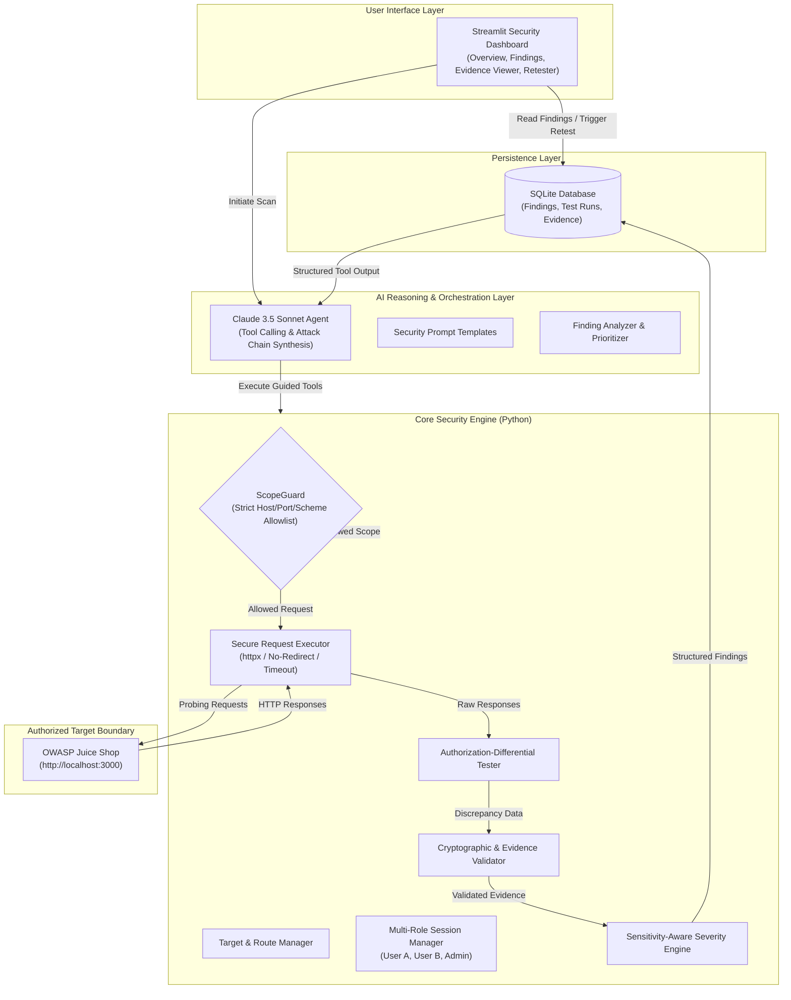

# AuthScope 🛡️🔍

**Authorized, Hard-Scoped AI-Powered Penetration Testing Agent**

AuthScope is an automated application security testing platform designed to detect **Broken Access Control**, **Insecure Direct Object References (IDOR)**, and **Multi-Endpoint Privilege Escalation Chains** against authorized targets.

Unlike chatbot-based security tools that speculate about vulnerabilities, AuthScope is built on an **evidence-driven architectural foundation**:
- **Python Security Engine:** Enforces hard boundary scopes, executes structured HTTP authorization-differential tests, and validates raw cryptographic/protocol proof.
- **AI Agent (Claude 3.5 Sonnet):** Reasons across application endpoint graphs, plans multi-role test matrices, synthesizes complex attack paths, and formulates precise remediation patches.
- **Interactive Security Dashboard (Streamlit):** Visualizes confirmed findings with full, non-destructive request/response evidence and automated one-click retesting.

---

## Architecture Overview



---

## Core Capabilities

1. **Hard Scope Enforcement:** Hardcoded, multi-layered Python boundary guards ensure requests never leave explicitly allowlisted domains, ports, and protocols.
2. **Multi-Role Authorization Matrix:** Automatically swaps authentication contexts (`Anonymous`, `Low-Privilege User A`, `Low-Privilege User B`, `Tenant Admin`) across identical endpoints.
3. **IDOR & BOLA Detection:** Identifies horizontal privilege escalation when User A accesses or modifies User B's resources.
4. **Vertical Privilege Escalation:** Verifies administrative routes and privileged actions against unprivileged tokens.
5. **Multi-Endpoint Attack Chain Reasoning:** The AI agent analyzes endpoint relationships to discover complex sequences (e.g., viewing another user's basket ID -> applying a payment coupon -> executing unauthorized checkout).
6. **Reproducible Non-Destructive Proof:** Findings require concrete request/response pairs with tamper-evident SHA-256 evidence hashing before being categorized as confirmed.
7. **Automated Retest Engine:** One-click re-execution of previously confirmed test vectors to verify remediation patches without re-scanning the entire application.

---

## Technology Stack

| Component | Technology | Rationale |
|---|---|---|
| **Language** | Python 3.10+ | Standard for cybersecurity scripting, AI orchestration, and rapid development |
| **Target App** | OWASP Juice Shop | Standardized, authorized, vulnerability-rich modern web application |
| **HTTP Client** | `httpx` | Fast, async-compatible HTTP client with fine-grained redirect and timeout control |
| **AI Reasoning** | Claude 3.5 Sonnet via Anthropic SDK | Industry-leading tool use, structured JSON formatting, and code reasoning |
| **Dashboard** | Streamlit | Rapid, stateful, clean cybersecurity operations interface |
| **Data Storage** | SQLite 3 | Lightweight, zero-configuration local relational persistence |
| **Validation** | Pydantic v2 | Strict schema validation and typed contract enforcement |
| **Testing** | pytest | Unit, integration, and security scope boundary test suites |

---

## Getting Started

### Prerequisites
- Python 3.10 or higher
- Git
- Docker (for hosting the target OWASP Juice Shop locally)
- Anthropic API Key

### 1. Clone & Set Up Environment

```bash
git clone https://github.com/your-org/authscope.git
cd authscope

# Create virtual environment
python -m venv .venv

# Activate virtual environment
# Windows:
.venv\Scripts\activate
# Linux/macOS:
# source .venv/bin/activate

# Install dependencies
pip install -r requirements.txt
```

### 2. Configure Environment Variables

```bash
cp .env.example .env
```
Edit `.env` and set your `ANTHROPIC_API_KEY`. The default settings target OWASP Juice Shop running locally on port 3000.

### 3. Start OWASP Juice Shop Target

Using Docker:
```bash
docker run -d --name authscope-juice-shop -p 3000:3000 bkimminich/juice-shop
```
Verify the application is accessible at `http://localhost:3000`.

### 4. Run Verification Tests

Run the test suite to verify scope guards and core contracts:
```bash
pytest
```

### 5. Launch the Security Dashboard

```bash
streamlit run dashboard/app.py
```

---

## Security & Ethics Disclaimer

> [!CAUTION]
> **AuthScope is intended exclusively for authorized security testing and research within environments you own or have explicit, documented permission to test.**
> 
> Scanning third-party infrastructure without written consent is illegal under computer misuse legislation (e.g., CFAA in the United States, Computer Misuse Act in the UK, Section 66 of the IT Act in India). AuthScope incorporates strict hardcoded scope boundaries designed to prevent unintended egress outside the authorized target.

---

## Development Status & Roadmap

AuthScope is currently in **Phase 1: Architecture & Foundation Initialization**.
See [docs/HACKATHON_ROADMAP.md](docs/HACKATHON_ROADMAP.md) for full phase milestones and [docs/SYSTEM_ARCHITECTURE.md](docs/SYSTEM_ARCHITECTURE.md) for architectural specifications.

