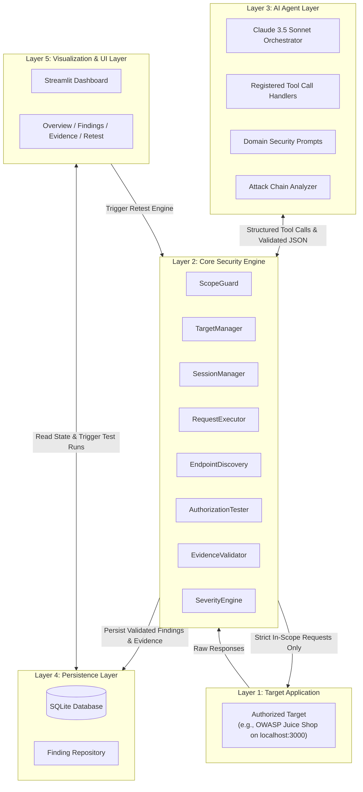

# AuthScope Engineering & Architecture Skill Manual

This document is the root-level operating manual for all developers and AI coding agents working on **AuthScope**. Every modification, pull request, and agent action must comply with the rules and architectural boundaries described herein.

---

## A. Project Identity

**AuthScope** is an authorized, hard-scoped, AI-powered penetration testing agent tailored for detecting:
1. **Broken Object Level Authorization (BOLA / IDOR)**
2. **Broken Function Level Authorization (BFLA)**
3. **Horizontal & Vertical Privilege Escalation**
4. **Multi-Endpoint Attack Chains**

### The Core Problem
Traditional web vulnerability scanners rely on brute-force fuzzing and signature matching. They fail at authorization logic flaws because authorization testing requires understanding semantic roles, resource ownership, state transitions, and business context. Chatbot-based security tools, conversely, guess vulnerabilities from code or text without running reproducible tests, generating dangerous false positives.

### Expected Outcomes
- **Evidence-Driven Security:** Every reported vulnerability contains verified, reproducible HTTP request/response payloads and SHA-256 evidence integrity hashes.
- **Strictly Contained:** Zero egress risk outside the explicit, authorized test target (default: local OWASP Juice Shop).
- **Actionable Remediation:** Pinpoint differential root cause analysis and concrete code remediation guidance.

---

## B. Five-Layer Architecture Understanding

AuthScope is designed with strict separation across five discrete layers:

### Information Flow
1. **Scope Initiation:** The user sets the authorized target in the Dashboard or configuration.
2. **Session Acquisition:** `SessionManager` authenticates pre-configured test personas (`Anonymous`, `Low-Privilege User A`, `Low-Privilege User B`, `Admin`) and retrieves session tokens.
3. **Attack Surface Mapping:** `EndpointDiscovery` parses OpenAPI specs, Swagger docs, or crawlers into normalized endpoint definitions.
4. **Agent Orchestration:** The AI Agent (`Claude 3.5 Sonnet`) evaluates candidate endpoints and invokes registered tool functions (e.g., `compare_access`, `test_idor_matrix`).
5. **Enforcement & Execution:** `ScopeGuard` validates the target URL, port, and method. `RequestExecutor` executes the requests with strict timeouts and disabled automatic redirects.
6. **Differential Comparison:** `AuthorizationTester` compares status codes, body hashes, and JSON keys across roles to detect authorization discrepancies.
7. **Evidence Cryptographic Hashing:** `EvidenceValidator` redacts sensitive tokens, validates non-destructive proof, and computes an immutable evidence signature.
8. **Storage & Dashboard:** Findings are saved to SQLite and surfaced immediately in the Streamlit UI with one-click retesting.

---

## C. Core Development Principles

1. **Modular Architecture:** Keep core logic decoupled. The scanner must work as a standalone Python library even without the AI agent or dashboard.
2. **Separation of Responsibilities:**
   - Security Engine = Executes and validates tests.
   - AI Agent = Synthesizes hypotheses, plans attack paths, and formats remediations.
   - Storage = Persists auditable evidence.
   - Dashboard = Renders state and facilitates human review.
3. **Reusable Functions:** Write cohesive, single-purpose functions.
4. **Type Hints Everywhere:** All function arguments and return values must be explicitly typed using Python 3.10+ standard typing and Pydantic models.
5. **Clear Naming Conventions:** Snake_case for functions/variables, PascalCase for classes, SCREAMING_SNAKE_CASE for constants.
6. **PEP 8 Compliance:** Adhere strictly to PEP 8 style standards with 4-space indentation.
7. **Defensive Error Handling:** Handle network drops, timeouts, and target resets gracefully with domain-specific exceptions.
8. **Structured Logging:** Use structured contextual logging (logger.info, logger.warning) instead of raw print statements.
9. **Zero Dependency Bloat:** Avoid heavy frameworks. Standard libraries + `httpx` + `pydantic` + `anthropic` + `streamlit` + `pytest` is sufficient.
10. **Test Coverage:** All scope logic, differential comparison algorithms, and evidence validators must have unit tests.

---

## D. Security-First Rules (Mandatory)

1. **Explicit Authorization Only:** Never scan any endpoint or system without confirmed authorization.
2. **Default Local Target:** The default target is strictly `http://localhost:3000` (OWASP Juice Shop).
3. **Target Allowlisting:** Hosts and IP addresses must match the configured allowlist. All other addresses are instantly rejected.
4. **Engine-Side Scope Validation:** Validate target validity inside Python tools, never trusting AI URL parameters.
5. **Network Protocol Restrictions:** Only HTTP/HTTPS is permitted. Protocols like `file://`, `gopher://`, or `ftp://` are immediately blocked.
6. **Strict Redirect Control:** Disable automatic HTTP redirects (`follow_redirects=False`) to prevent SSRF and to properly analyze 301/302 redirects.
7. **No Shell Execution:** Under no circumstances should the agent invoke shell commands or OS sub-processes during scanning.
8. **No Control Bypasses:** The AI cannot override safety controls or force out-of-scope executions.
9. **Strictly Non-Destructive:** Probing must not delete users, drop tables, or trigger permanent Denial-of-Service states.
10. **Zero Secret Leakage:** Never print, log, or persist unmasked API keys, passwords, or raw session cookies.
11. **Evidence Redaction:** Automatically sanitize Authorization headers, session cookies, and sensitive PII before saving evidence.
12. **Cryptographic Reproducibility:** Every confirmed finding must contain an exact raw request, raw response, and SHA-256 evidence hash.
13. **Role Isolation:** Maintain strict cryptographic and state separation between test roles (User A, User B, Admin).
14. **No Guessed Vulnerabilities:** A finding is classified as `CONFIRMED` only when verified by differential response analysis.

---

## E. AI Agent Rules

- **Restricted Tool Execution:** The agent interacts with target environments strictly via registered, typed tool definitions.
- **Structured JSON Communication:** The model communicates via validated Pydantic schemas.
- **No Direct Socket Access:** The agent has zero direct network socket or HTTP access.
- **Evidence-Based Grounding:** Every vulnerability report produced by the agent must cite specific response payloads, status codes, and differential keys.
- **Pragmatic Remediation:** Remediations must be production-ready code patches (e.g., proper role-based authorization middleware or database ownership checks).
- **Human Approval Gate:** If an endpoint suggests a state change on an untested resource or scope expansion, the agent must require explicit operator confirmation.

---

## F. Systematic Coding Workflow

When implementing any feature in this repository:

1. **Read SKILL.md:** Re-verify project requirements and boundary constraints.
2. **Read Domain SKILL.md:** Inspect the domain-specific skill in `skills/<domain>/SKILL.md`.
3. **Review System Architecture:** Check `docs/SYSTEM_ARCHITECTURE.md` and `docs/API_CONTRACTS.md`.
4. **Inspect Existing Files:** Ensure no overlapping or duplicate code is written.
5. **Identify Contracts:** Verify input/output types with Pydantic schemas.
6. **Implement Minimal Working Unit:** Write clean, typed, modular code.
7. **Execute Test Suite:** Run `pytest` and verify no regressions.
8. **Update Documentation:** Keep `docs/` and `CHANGELOG.md` synchronized.
9. **Report Summary:** Document changes, test results, and files created.

*Never rewrite working code without an explicit, documented architectural justification.*

