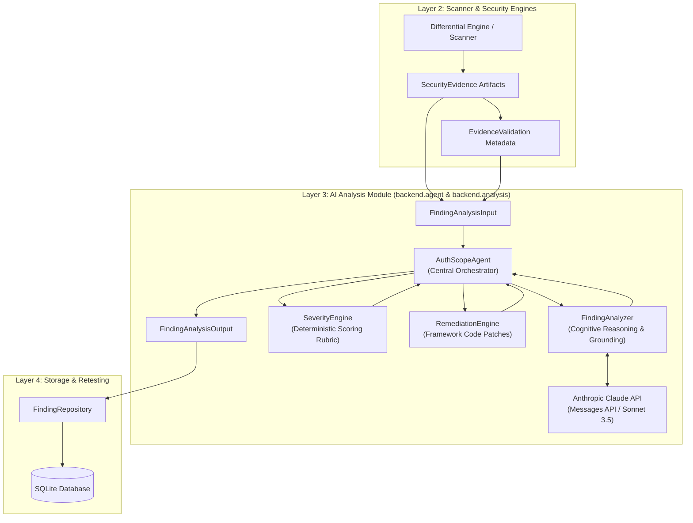

# AuthScope AI Analysis Module — Technical Architecture & Integration Guide

## 1. Module Architecture

The **AI Analysis Module** sits in Layer 3 of AuthScope's architecture, bridging empirical evidence artifacts collected by the security engines (Layer 2) and persistent storage / dashboards (Layers 4 & 5).



### Key Architectural Principles
- **Evidence-Grounded**: Operates purely on validated, empirical HTTP transactions and differential response pairs. Never speculates vulnerabilities without supporting evidence.
- **Strict Scope Isolation**: Zero direct network socket execution or shell invocation. Egress HTTP requests are barred from the reasoning engine.
- **Anti-Hallucination & Anti-Upgrade**: Confirmation status is determined solely by trusted validation metadata; Claude cannot independently mark an unverified finding as `CONFIRMED`.
- **Deterministic Risk Scoring**: Severity tiers and CVSS numeric ratings are calculated strictly by mathematical rubric formula, never inflated or overridden by LLM opinion.

---

## 2. Component Responsibilities

| Component | Module Path | Core Responsibilities |
| :--- | :--- | :--- |
| **`AuthScopeAgent`** | `backend.agent.agent` | Central orchestrator coordinating finding analysis, Claude API communication, exponential backoff retries, error handling, severity scoring, and remediation synthesis. |
| **`FindingAnalyzer`** | `backend.agent.finding_analyzer` | Cognitive engine inspecting evidence artifacts, establishing differential context, estimating confidence, and producing grounded vulnerability explanations. |
| **`SeverityEngine`** | `backend.analysis.severity_engine` | Deterministic CVSS 3.1 & data sensitivity risk calculation engine implementing the 6-factor scoring rubric and anti-inflation safeguards. |
| **`RemediationEngine`** | `backend.analysis.remediation` | Framework-tailored mitigation synthesizer generating server-side middleware patches, retesting procedures, and regression test suites. |
| **`PromptLayer`** | `backend.agent.prompts` | Secure prompt templates, delimiter tags (`<untrusted_security_evidence>`), and tag breakout sanitizers. |
| **`Schemas`** | `backend.agent.schemas` | Pydantic v2 data boundary models with runtime validation and anti-hallucination model validators. |

---

## 3. Input & Output Schemas

All data boundaries are enforced via **Pydantic v2** models with `extra="forbid"`.

### Input: `FindingAnalysisInput`
```python
class FindingAnalysisInput(BaseModel):
    finding_id: str
    vulnerability_category: VulnerabilityCategory  # BOLA_IDOR, BFLA, MISSING_AUTH, etc.
    security_evidence: List[SecurityEvidence]      # Min 1 empirical evidence artifact
    affected_resource: AffectedResource            # Endpoint, resource ID, application name
    user_role_context: Optional[str] = None        # e.g., 'user_a', 'user_b', 'anonymous'
    testing_context: Dict[str, Any] = Field(default_factory=dict)
    scope_info: Optional[Dict[str, Any]] = None
    evidence_validation: Optional[EvidenceValidation] = None
```

### Output: `FindingAnalysisOutput`
```python
class FindingAnalysisOutput(BaseModel):
    analysis: FindingAnalysis                      # Grounded narrative, root cause, impact
    severity_assessment: SeverityAssessment        # Deterministic score, tier, and factors
    remediation_recommendation: RemediationRecommendation # Code patch and retest guide
    evidence_references: List[str]                 # IDs of evidence artifacts supporting output
    overall_status: AnalysisStatus                 # 'completed', 'requires_further_testing', etc.
    warnings_or_limitations: List[str]             # Operational notes or missing evidence gaps
```

---

## 4. Claude API Integration

- **SDK**: Official `anthropic` Python SDK.
- **Interface**: Messages API (`client.messages.create`).
- **Default Model**: `claude-3-5-sonnet-20241022`.
- **Temperature**: `0.0` (deterministic, reproducible security analysis).
- **Injection Defense**: Untrusted evidence (raw HTTP headers, bodies, URLs) is wrapped in strict boundary delimiters:
  ```xml
  <untrusted_security_evidence>
  { ... sanitized JSON payload ... }
  </untrusted_security_evidence>
  ```
  Any embedded closing tags (`</untrusted_security_evidence>`) are escaped to `<\\/untrusted_security_evidence>` to prevent prompt breakout.

---

## 5. Severity Scoring Formula

The `SeverityEngine` uses an objective, multi-factor scoring rubric:

$$\text{Raw Score} = \left( \frac{\text{DS}}{4} \times 0.25 + \frac{\text{PG}}{3} \times 0.25 + \frac{\text{EX}}{3} \times 0.25 + \frac{\text{PI}}{3} \times 0.15 + \frac{\text{AC}}{2} \times 0.10 \right) \times 10.0$$

$$\text{Final Score} = \text{round}(\text{Raw Score} \times \text{Confidence Multiplier}, 1)$$

### Factors & Scales:
1. **Data Sensitivity (DS, 0-4)**: Public (0), Low (1), Internal (2), Confidential/PII (3), Credentials/Keys (4).
2. **Privilege Gained (PG, 0-3)**: None (0), Limited (1), Horizontal Cross-Tenant (2), Vertical Admin (3).
3. **Exploitability (EX, 0-3)**: Theoretical (0), High Prerequisites (1), Limited Conditions (2), Reproducible Direct (3).
4. **Potential Impact (PI, 0-3)**: Negligible (0), Minor (1), Moderate Tenant Data Breach (2), Critical Takeover (3).
5. **Attack Complexity (AC, 0-2)**: High Complexity (0), Medium Complexity (1), Low Complexity / Direct Tampering (2).
6. **Evidence Confidence Multiplier**: High Confidence (1.00), Moderate Confidence (0.85), Low / Unvalidated (0.65).

### Anti-Inflation Safeguards:
- **Safeguard 1**: If $\text{DS} = 0$ and $\text{PG} = 0$, score is capped at $3.9$ (`LOW`).
- **Safeguard 2**: Score $\ge 9.0$ (`CRITICAL`) requires High Confidence ($\text{EC} = 2$), High Exploitability ($\text{EX} \ge 2$), and either Admin Privilege ($\text{PG} = 3$), Credentials ($\text{DS} = 4, \text{PI} \ge 2$), or Severe Impact ($\text{PI} = 3$).
- **Safeguard 3**: Unverified / Low Confidence ($\text{EC} = 0$) findings are capped at $6.9$ (`MEDIUM`) and cannot reach `HIGH` or `CRITICAL`.
- **Safeguard 4**: AI contextual explanations cannot override or alter the calculated numeric score.

---

## 6. Remediation Workflow

The `RemediationEngine` generates production-grade, server-side defense-in-depth remediations:

1. **Framework Normalization**: Maps requested framework (`express`, `fastapi`, `spring`, `django`) to standardized templates.
2. **Control Enforcement**: Recommends server-side authorization controls (e.g. `ServerSideOwnershipMiddleware`, `RBACRoleGuard`). Client-side-only checks are strictly rejected.
3. **Multi-Step Mitigation Package**:
   - `recommended_fix`: High-level architectural fix description.
   - `technical_implementation_guidance`: Concrete runnable code snippet.
   - `root_cause_correction`: Explanation of how the fix repairs the underlying logic defect.
   - `additional_security_controls`: Defense-in-depth controls (rate limiting, auditing).
   - `retesting_procedure`: Step-by-step verification instructions.
   - `regression_testing_recommendations`: Automated unit and integration test suggestions.

---

## 7. Error Handling

| Scenario | Handling Strategy |
| :--- | :--- |
| **Authentication Error (401)** | Caught as `anthropic.AuthenticationError`; immediately raises `AgentAuthenticationError` without retrying. |
| **Rate Limiting (429)** | Caught as `anthropic.RateLimitError`; retries up to 3 times with exponential backoff ($1\text{s}, 2\text{s}, 4\text{s}$). |
| **API Timeout** | Caught as `anthropic.APITimeoutError`; retries up to 3 times, then raises `AgentAPIError`. |
| **Malformed JSON** | Strips markdown fences (```` ```json ````); if JSON parsing fails, logs warning and falls back to deterministic synthesis. |
| **Schema Violation** | Pydantic validation rejects invalid payloads; agent logs violation and generates deterministic fallback. |
| **Missing API Key** | Initializes in offline fallback mode with warning; operates deterministically without throwing exceptions. |

---

## 8. Environment Variables

| Variable | Type | Default | Description |
| :--- | :--- | :--- | :--- |
| `ANTHROPIC_API_KEY` | String | `""` | Anthropic API key. When absent, agent runs in deterministic offline mode. |
| `ANTHROPIC_MODEL` | String | `claude-3-5-sonnet-20241022` | Claude model name for cognitive reasoning. |
| `ANTHROPIC_MAX_TOKENS` | Integer | `2048` | Maximum completion token budget. |
| `ANTHROPIC_TIMEOUT` | Float | `30.0` | Network request timeout in seconds. |

---

## 9. Testing Instructions

All unit and integration tests run **100% offline without live Claude API credentials or external network access**:

```powershell
# Run the complete test suite
& "d:\authscope\.venv\Scripts\python.exe" -m pytest -v

# Run the dedicated comprehensive validation suite
& "d:\authscope\.venv\Scripts\python.exe" -m pytest tests/test_ai_validation_suite.py -v

# Run the agent orchestrator suite
& "d:\authscope\.venv\Scripts\python.exe" -m pytest tests/test_agent_orchestrator.py -v
```

---

## 10. Future Integration Instructions

When connecting the AI Analysis Module to Layer 2 (Scanner) and Layer 4 (Storage):

1. **Integrating with Scanner / Differential Engine:**
   ```python
   from backend.agent.agent import AuthScopeAgent
   from backend.agent.schemas import FindingAnalysisInput

   agent = AuthScopeAgent()
   input_data = FindingAnalysisInput.model_validate(scanner_finding_payload)
   output = agent.analyze_finding(input_data, target_framework="express")
   ```

2. **Persisting to SQLite Database:**
   ```python
   from backend.storage.finding_repository import FindingRepository
   from backend.storage.models import FindingRecord

   record = FindingRecord(
       id=output.analysis.supporting_evidence[0].evidence_id,
       scan_id=scan_session_id,
       title=output.analysis.title,
       vulnerability_type=input_data.vulnerability_category.value,
       severity=output.severity_assessment.severity,
       status=output.analysis.confirmation_status.value,
       target_endpoint=input_data.affected_resource.endpoint,
       http_method=input_data.security_evidence[0].http_method or "GET",
       description=output.analysis.vulnerability_explanation,
       remediation_guidance=output.remediation_recommendation.recommended_fix,
   )
   repo.save_finding(record)
   ```

3. **Dashboard Consumption:**
   Use `output.model_dump()` or `agent.analyze_finding_json(input_data)` to stream structured JSON directly to the Streamlit UI.

