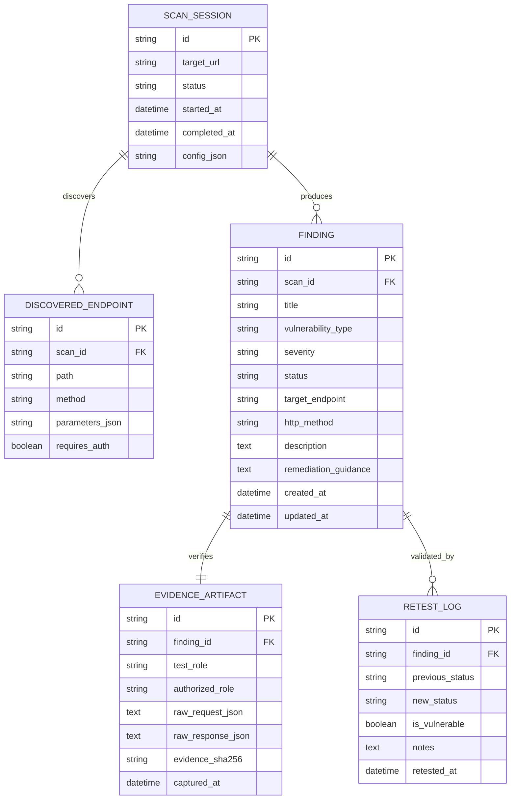

# AuthScope: Database Schema & Persistence Model

AuthScope uses a lightweight local SQLite database (`data/authscope.db`) for storing scans, endpoints, findings, evidence artifacts, and retest execution histories.

---

## 1. Entity-Relationship Diagram



---

## 2. Table Definitions (SQL DDL)

```sql
CREATE TABLE IF NOT EXISTS scan_sessions (
    id TEXT PRIMARY KEY,
    target_url TEXT NOT NULL,
    status TEXT NOT NULL, -- RUNNING, COMPLETED, FAILED
    started_at TIMESTAMP DEFAULT CURRENT_TIMESTAMP,
    completed_at TIMESTAMP,
    config_json TEXT
);

CREATE TABLE IF NOT EXISTS discovered_endpoints (
    id TEXT PRIMARY KEY,
    scan_id TEXT NOT NULL REFERENCES scan_sessions(id) ON DELETE CASCADE,
    path TEXT NOT NULL,
    method TEXT NOT NULL,
    parameters_json TEXT,
    requires_auth BOOLEAN DEFAULT 1
);

CREATE TABLE IF NOT EXISTS findings (
    id TEXT PRIMARY KEY,
    scan_id TEXT NOT NULL REFERENCES scan_sessions(id) ON DELETE CASCADE,
    title TEXT NOT NULL,
    vulnerability_type TEXT NOT NULL, -- BOLA_IDOR, BFLA, MISSING_AUTH, etc.
    severity TEXT NOT NULL,           -- CRITICAL, HIGH, MEDIUM, LOW, INFO
    status TEXT NOT NULL,             -- suspected, confirmed, remediated, false_positive
    target_endpoint TEXT NOT NULL,
    http_method TEXT NOT NULL,
    description TEXT NOT NULL,
    remediation_guidance TEXT NOT NULL,
    created_at TIMESTAMP DEFAULT CURRENT_TIMESTAMP,
    updated_at TIMESTAMP DEFAULT CURRENT_TIMESTAMP
);

CREATE TABLE IF NOT EXISTS evidence_artifacts (
    id TEXT PRIMARY KEY,
    finding_id TEXT NOT NULL UNIQUE REFERENCES findings(id) ON DELETE CASCADE,
    test_role TEXT NOT NULL,
    authorized_role TEXT NOT NULL,
    raw_request_json TEXT NOT NULL,
    raw_response_json TEXT NOT NULL,
    evidence_sha256 TEXT NOT NULL,
    captured_at TIMESTAMP DEFAULT CURRENT_TIMESTAMP
);

CREATE TABLE IF NOT EXISTS retest_logs (
    id TEXT PRIMARY KEY,
    finding_id TEXT NOT NULL REFERENCES findings(id) ON DELETE CASCADE,
    previous_status TEXT NOT NULL,
    new_status TEXT NOT NULL,
    is_vulnerable BOOLEAN NOT NULL,
    notes TEXT,
    retested_at TIMESTAMP DEFAULT CURRENT_TIMESTAMP
);
```

