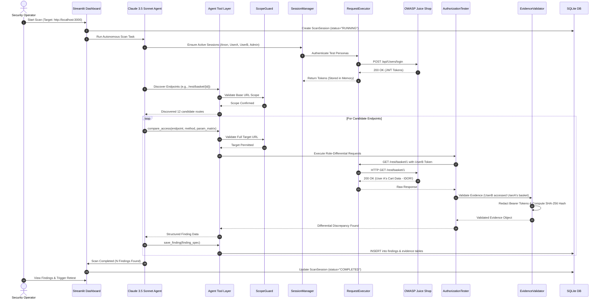

# AuthScope: Data Flow & Lifecycle

This document describes how data enters, transitions through, and persists across AuthScope's components.

---

## 1. End-to-End Execution Flow

---

## 2. Data Transformation States

### State 1: Discovery Input
- Raw OpenAPI JSON / HTML crawling routes / configured endpoint lists.
- Normalized into `DiscoveredEndpoint` models with path parameters (e.g., `{id}`).

### State 2: Request Execution Context
- `ExecutionContext`: Role identity (`UserA`, `UserB`, `Admin`, `Anonymous`), target URL, HTTP method, headers, JSON body, query parameters.
- Evaluated against `ScopeGuard` rules prior to transmission.

### State 3: Raw HTTP Exchange
- Raw HTTP request wire bytes (method, full URL, headers, body).
- Raw HTTP response wire bytes (status code, headers, body, latency).

### State 4: Normalized Evidence Object
- Authentication headers and sensitive tokens replaced with `[REDACTED_BEARER_TOKEN]`.
- Response payloads parsed and summarized.
- Checksum computed via SHA-256 (`evidence_hash`).

### State 5: Persisted Finding Record
- Pydantic `FindingRecord` stored in SQLite containing:
  - Finding UUID
  - Vulnerability Type (e.g., `BOLA_IDOR`, `BFLA`)
  - Target Endpoint & Method
  - Discrepancy Matrix (Status codes & response hashes per role)
  - Severity (CVSS + Data sensitivity)
  - Claude Reasoned Explanation
  - Remediation Patch Guidance
  - Non-destructive reproduction steps

