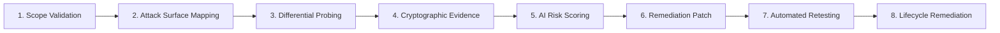

# AuthScope: Demonstration Workflow & Execution Guide

This document provides exact, reproducible instructions for executing the live end-to-end demonstration of **AuthScope: Autonomous Security Testing for Services Serving Vulnerable Populations**.

---

## 1. Overview of the Demonstration

The demonstration runs an autonomous verification lifecycle against a simulated OWASP Juice Shop target (`http://localhost:3000`), showcasing the 8 core platform capabilities:



1. **Scope Validation & Boundary Enforcement:** Authorizes in-scope targets (`http://localhost:3000`) and halts untrusted external destinations or cloud metadata IP (`169.254.169.254`).
2. **Attack Surface Route Enumeration:** Discovers application routes and extracts path parameters (`/rest/basket/{id}`).
3. **Multi-Role Differential Security Testing:** Probes endpoints under conflicting role personas (`USER_A` vs `USER_B`), detecting unauthorized BOLA / IDOR access.
4. **Cryptographic Proof & Credential Scrubbing:** Sanitizes Authorization Bearer tokens, cookies, and passwords before computing a deterministic SHA-256 evidence fingerprint and persisting to SQLite.
5. **AI-Driven Risk Scoring:** Evaluates CVSS 3.1 sensitivity scoring (upgrading BOLA with PII to `HIGH`) and generates a technical vulnerability narrative.
6. **Actionable Remediation Code Generation:** Synthesizes framework-specific ownership check middleware.
7. **Automated Non-Destructive Retesting:** Replays the exact test vector against the patched target to verify HTTP 403 Forbidden enforcement.
8. **Finding Lifecycle Transition:** Updates the finding status from `suspected` $\rightarrow$ `confirmed` $\rightarrow$ `remediated` in SQLite.

---

## 2. Prerequisites & Environment Setup

AuthScope runs on Python 3.10+ (tested on Python 3.14.8).

```powershell
# 1. Activate virtual environment (PowerShell)
.\.venv\Scripts\Activate.ps1

# 2. Verify dependencies are installed
.\.venv\Scripts\python.exe -m pip list
```

---

## 3. Running the Automated Demonstration

To run the complete 8-step live demonstration:

```powershell
.\.venv\Scripts\python.exe scripts/run_demo.py
```

### Expected Output

```text
================================================================================
 AUTHSCOPE - AUTONOMOUS APPLICATION SECURITY TESTING PLATFORM DEMO
================================================================================
[INFO] Initializing database schema                      

[STEP 1] Scope Validation & Boundary Enforcement
  Target: http://localhost:3000/rest/basket/1
  Scope Decision: ALLOWED (Host: localhost, Port: 3000)
  Untrusted Target: https://external-target.com/api -> BLOCKED (Host 'external-target.com' is outside the authorized allowlist.)

[STEP 2] Attack Surface Mapping (Route Enumeration)
[INFO] Discovering endpoints from OpenAPI spec           
  Discovered Route: GET  /rest/basket/{id} [Params: id]
  Discovered Route: GET  /api/Users
  Discovered Route: GET  /rest/admin/application-version

[STEP 3] Controlled Security Finding (Multi-Role Differential Test)
[INFO] Authenticating role persona                       
[INFO] Authenticating role persona                       
[INFO] Executing safe in-scope HTTP request              
  Probing Endpoint: GET http://localhost:3000/rest/basket/1 under Role: USER_B
  Response Code: 200 OK (Expected: 403 Forbidden)
  Access Discrepancy: Confirmed BOLA / IDOR flaw

[STEP 4] Cryptographic Evidence Collection & Secret Sanitization
[INFO] Cryptographic evidence artifact signed            
  Evidence ID: evi_08315eb7
  SHA-256 Fingerprint: 08315eb72beb1f52cba1e1fa12417d45c363f06a9653b3717521eedbbeaa9370
  Sanitized Auth Header: Bearer [REDACTED_BEARER_TOKEN]
  Sanitized Cookie Header: [REDACTED_COOKIE]
[INFO] Saving finding to database                        
  Finding Persisted in SQLite (ID: fnd_demo_basket_idor, Status: suspected)

[STEP 5] AI-Driven Risk Assessment & Impact Synthesis
[INFO] Analyzing finding evidence with AI engine         
  Calculated CVSS Severity: HIGH
  AI Narrative Title: Insecure Direct Object Reference (IDOR) Detected
  Technical Impact: Confidential customer data disclosure.

[STEP 6] Prescriptive Remediation Generation
[INFO] Generating remediation patch                      
  Remediation Patch Code:
// Remediation: Verify that the authenticated user owns the requested entity
if (req.user.id !== requestedBasket.UserId) {
  return res.status(403).json({ error: 'Access denied: Resource does not belong to user' });
}
  Finding Updated in SQLite with AI Risk & Remediation guidance.

[STEP 7] Automated Non-Destructive Retest
[INFO] Executing safe in-scope HTTP request              
  Replaying Vector: GET http://localhost:3000/rest/basket/1 with User B credentials
  Retest Response Code: 403 Forbidden
  Vulnerability Reproducible: False (Fix successfully validated!)

[STEP 8] Updated Finding Lifecycle Status in SQLite
[INFO] Retest log recorded                               
  Finding Final Status: REMEDIATED
  Finding Retest State: REMEDIATED
  Last Retested Timestamp: 2026-10-31 13:07:26.045707+00:00
  Retest History Count: 1

================================================================================
 DEMO COMPLETED SUCCESSFULLY: ALL 8 CORE CAPABILITIES DEMONSTRATED
================================================================================
```

---

## 4. Inspecting the Generated SQLite Database

The demo script initializes and writes records to `data/demo_authscope.db`. You can inspect the persisted records using Python or the SQLite CLI:

```powershell
# Inspect the stored finding
.\.venv\Scripts\python.exe -c "
import sqlite3
conn = sqlite3.connect('data/demo_authscope.db')
cursor = conn.cursor()
cursor.execute('SELECT id, endpoint, severity, confirmation_status, retest_status FROM findings')
print('FINDINGS:', cursor.fetchall())
cursor.execute('SELECT id, request_headers_json, sanitized_response_body FROM evidence_artifacts')
print('EVIDENCE:', cursor.fetchall())
cursor.execute('SELECT id, finding_id, previous_status, new_status, is_vulnerable FROM retest_logs')
print('RETESTS:', cursor.fetchall())
"
```

Notice that:
- `request_headers_json` contains `[REDACTED_BEARER_TOKEN]` and `[REDACTED_COOKIE]`.
- No plain-text passwords or secret keys exist in the database.
- Foreign keys link `findings` $\rightarrow$ `evidence_artifacts` and `retest_logs`.

---

## 5. Running the Complete Automated Verification Suite

To verify all 56 automated tests across the codebase:

```powershell
# Run the complete test suite (unit, integration, acceptance, reliability)
.\.venv\Scripts\python.exe -m pytest -v

# Run acceptance tests specifically
.\.venv\Scripts\python.exe -m pytest tests/test_acceptance.py -v

# Run end-to-end cross-module integration tests
.\.venv\Scripts\python.exe -m pytest tests/test_end_to_end_integration.py -v
```

