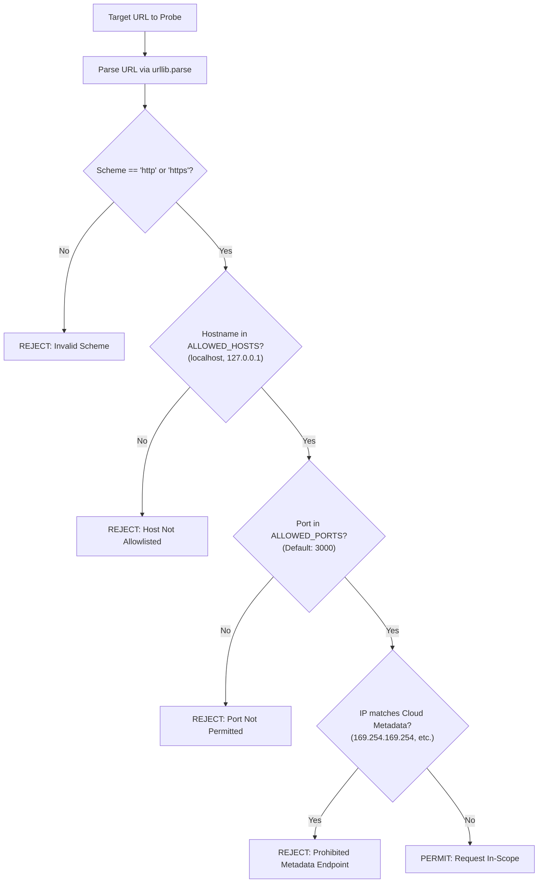

# AuthScope: Scope & Authorization Model

This document outlines the scope guard validation algorithm and multi-role authorization architecture.

---

## 1. ScopeGuard Validation Architecture

`ScopeGuard` enforces that every target candidate meets the following criteria before an HTTP connection is initiated:

### URL Normalization Rules
1. Strip duplicate slashes (`//` -> `/`).
2. Reject non-printable ASCII or homoglyph domain representations.
3. Resolve explicit IP mappings to prevent DNS rebinding attacks.

---

## 2. Multi-Role Testing Model

AuthScope provisions and manages four distinct testing roles to model differential authorization:

| Role Identifier | Description | Privilege Level | Expected Access |
|---|---|---|---|
| `ANONYMOUS` | Unauthenticated web visitor (no cookies or tokens) | Zero | Public product lists, login page, public assets |
| `USER_A` | Valid registered customer (Victim persona) | Standard Low | Own profile, own cart, own order history |
| `USER_B` | Valid registered customer (Attacker persona) | Standard Low | Own profile, own cart, own order history |
| `ADMIN` | System administrator | Elevated | User management, system metrics, administrative panels |

---

## 3. Authorization-Differential Matrix

When testing an endpoint (e.g., `GET /rest/basket/{basketId}` where `basketId=1` belongs to `USER_A`):

| Role Tested | Actual Response | Expected Secure Behavior | AuthScope Verdict |
|---|---|---|---|
| `USER_A` | `200 OK` (Basket 1 items) | `200 OK` | Normal Legitimate Access |
| `USER_B` | `200 OK` (Basket 1 items) | `403 Forbidden` or `404 Not Found` | **VULNERABILITY: BOLA / IDOR Confirmed** |
| `ANONYMOUS` | `200 OK` (Basket 1 items) | `401 Unauthorized` | **VULNERABILITY: Missing Authentication** |
| `ADMIN` | `200 OK` (Basket 1 items) | `200 OK` | Administrative Access (Depends on RBAC spec) |

