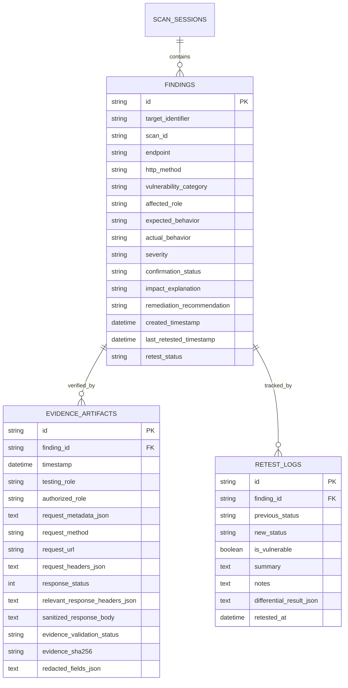

# AuthScope: Storage, Evidence Management & Integration Guide

## 1. Overview & Architecture

The AuthScope persistence layer (Layer 4) provides secure, auditable, and immutable storage for:
- Penetration testing scan sessions
- Verified authorization findings (BOLA/IDOR, BFLA, Missing Auth, Mass Assignment, Privilege Escalation)
- Cryptographic evidence artifacts with token/password/cookie redaction and SHA-256 integrity signatures
- Non-destructive retest histories and remediation tracking

Built on SQLite with strict parameterization (`?`) and Pydantic v2 validation boundaries, this layer enforces **Enforcement Point 4 (Data Redaction)** before any sensitive information can be saved to disk.

---

## 2. Database Schema (SQLite)

The database schema is initialized and managed by `backend.storage.database.DatabaseManager`. Foreign key constraints (`PRAGMA foreign_keys = ON;`) and performance indexes are automatically enforced.



---

## 3. Data Contracts & Models

All models reside in `backend.storage.models` and enforce automatic redaction and bidirectional attribute normalization.

### 3.1 `FindingRecord`
Represents an authorization security finding.
```python
from backend.storage.models import FindingRecord, SeverityLevel, VulnerabilityType

finding = FindingRecord(
    id="fnd_idor_01",
    target_identifier="scan_01",              # or scan_id
    endpoint="/rest/basket/1",                # or target_endpoint
    http_method="GET",
    vulnerability_category="BOLA_IDOR",       # or vulnerability_type
    affected_role="user_b",                   # or affected_roles=["user_b"]
    expected_behavior="Return 403 Forbidden for peer cart",
    actual_behavior="Returned 200 OK with User A data",
    severity=SeverityLevel.HIGH,              # CRITICAL, HIGH, MEDIUM, LOW, INFO
    confirmation_status="confirmed",          # suspected, confirmed, remediated, false_positive
    impact_explanation="Horizontal IDOR data leak",
    remediation_recommendation="Verify basket.UserId == req.user.id",
    evidence=evidence_artifact                # Optional[EvidenceArtifact]
)
```

### 3.2 `EvidenceArtifact`
Represents sanitized, reproducible cryptographic proof.
```python
from backend.storage.models import EvidenceArtifact

evidence = EvidenceArtifact(
    id="evi_8a4f91c2",                        # Auto-generated if omitted
    finding_id="fnd_idor_01",
    testing_role="user_b",                    # testing_role / test_role
    authorized_role="user_a",
    request_method="GET",
    request_url="http://localhost:3000/rest/basket/1",
    request_headers={
        "Authorization": "Bearer [REDACTED_TOKEN]",  # Automatically redacted
        "Cookie": "connect.sid=[REDACTED_COOKIE]",   # Automatically redacted
        "X-Api-Key": "[REDACTED_KEY]"               # Automatically redacted
    },
    response_status=200,
    sanitized_response_body='{"user": "alice", "items": ["item1"]}', # Passwords/JWTs scrubbed
    evidence_validation_status="valid"        # valid, invalid, unverified
)
# Note: evidence.evidence_sha256 is auto-computed if omitted
```

### 3.3 `RetestLogRecord`
Tracks historical regression re-verifications.
```python
from backend.storage.models import RetestLogRecord

retest = RetestLogRecord(
    id="ret_001",                             # Auto-generated if omitted
    finding_id="fnd_idor_01",
    previous_status="confirmed",
    new_status="remediated",                  # or confirmed
    is_vulnerable=False,                      # False if fix verified
    summary="Target returned 403 Forbidden on differential replay",
    notes="Ownership validation middleware active"
)
```

---

## 4. Repository Interface (`FindingRepository`)

```python
from backend.storage.finding_repository import FindingRepository

repo = FindingRepository()
```

### Methods:

| Method | Parameters | Return Type | Description |
|---|---|---|---|
| `initialize_database()` | None | `None` | Initializes DDL tables and indexes |
| `save_finding()` | `finding: FindingRecord \| dict, overwrite: bool = False` | `str` (finding ID) | Inserts finding & evidence. Raises `DuplicateRecordError` if ID exists and `overwrite=False`. |
| `get_finding()` | `finding_id: str` | `Optional[FindingRecord]` | Retrieves finding with its attached `EvidenceArtifact` |
| `get_all_findings()` | `target_identifier=None, scan_id=None, status=None, severity=None, vulnerability_category=None` | `List[FindingRecord]` | Queries findings matching filters ordered by creation time DESC |
| `list_findings()` | `scan_id=None` | `List[FindingRecord]` | Backwards-compatible alias for `get_all_findings(scan_id=scan_id)` |
| `update_finding()` | `finding_id: str, update_data: FindingRecord \| dict` | `FindingRecord` | Updates finding fields and evidence. Raises `RecordNotFoundError` if missing. |
| `save_retest_result()` | `retest: RetestLogRecord \| dict` | `str` (retest ID) | Persists retest log and updates finding `last_retested_timestamp` & `retest_status` |
| `get_retest_history()` | `finding_id: Optional[str] = None` | `List[RetestLogRecord]` | Retrieves retests ordered chronologically DESC |
| `delete_finding()` | `finding_id: str` | `bool` | Deletes finding and cascades deletion to evidence and retest logs |

---

## 5. Team Integration Points

### 5.1 Member 1 (Backend & Security Engine Lead)
- When `AuthorizationTester` discovers a differential anomaly and confirms access discrepancy:
  1. Call `EvidenceValidator.create_and_sign_evidence(...)` to redact secrets and generate SHA-256 hash.
  2. Instantiate `FindingRecord(...)` with `evidence=artifact`.
  3. Call `repo.save_finding(finding)`.

### 5.2 Member 2 (AI Agent & Vulnerability Analysis Lead)
- When Claude 3.5 Sonnet synthesizes technical impact or remediation:
  1. Load existing finding via `repo.get_finding(finding_id)`.
  2. Augment remediation guidance or chain notes using `repo.update_finding(finding_id, {"remediation_recommendation": patch_code})`.
  3. Read verified findings for multi-step attack chain correlation via `repo.get_all_findings()`.

### 5.3 Member 3 (Dashboard & UI/UX Lead)
- Streamlit views interact directly with `FindingRepository`:
  1. **Overview & Findings Explorer:** Call `repo.list_findings()` or `repo.get_all_findings()`.
  2. **Evidence Viewer:** Display `finding.evidence.request_headers`, `finding.evidence.sanitized_response_body`, and `finding.evidence.evidence_sha256`.
  3. **Retest Console:** Trigger retest via `RetestEngine`, save outcome via `repo.save_retest_result(...)`, and view historical trends via `repo.get_retest_history(finding_id)`.

---

## 6. How to Run Tests

AuthScope uses `pytest` for all unit, boundary, and regression tests.

```powershell
# Run the complete test suite (all 29 tests)
.\.venv\Scripts\python.exe -m pytest

# Run storage & evidence tests specifically
.\.venv\Scripts\python.exe -m pytest tests/test_storage.py

# Run with verbose output and coverage
.\.venv\Scripts\python.exe -m pytest -v
```

