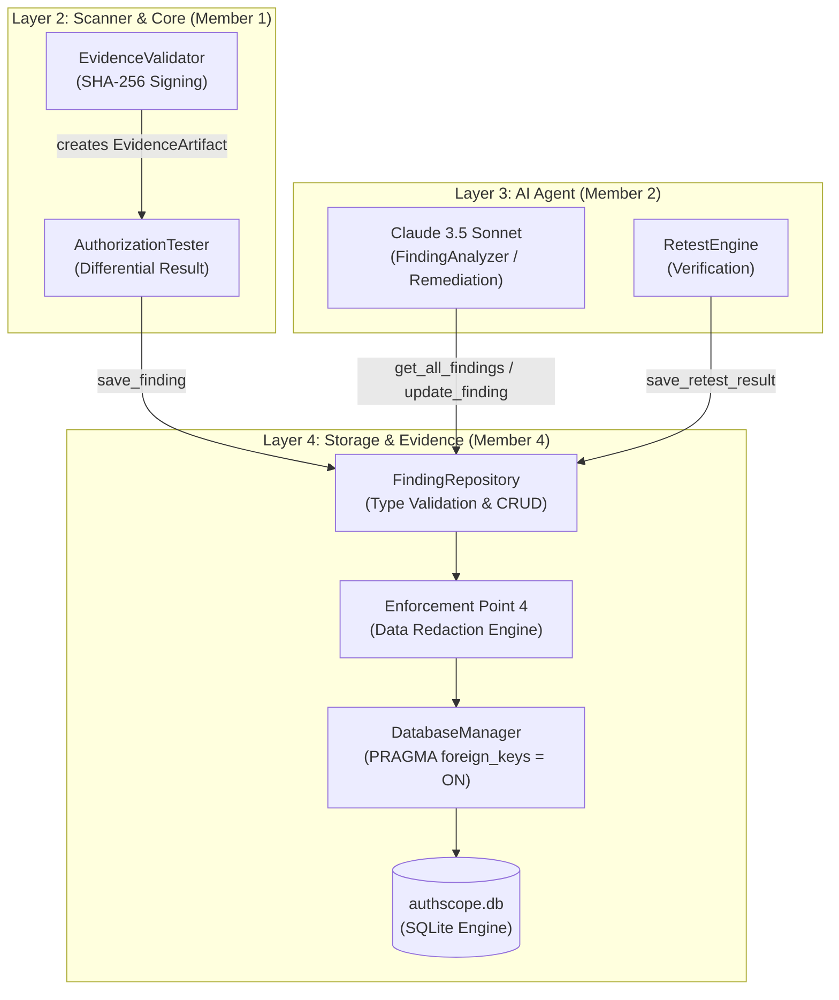
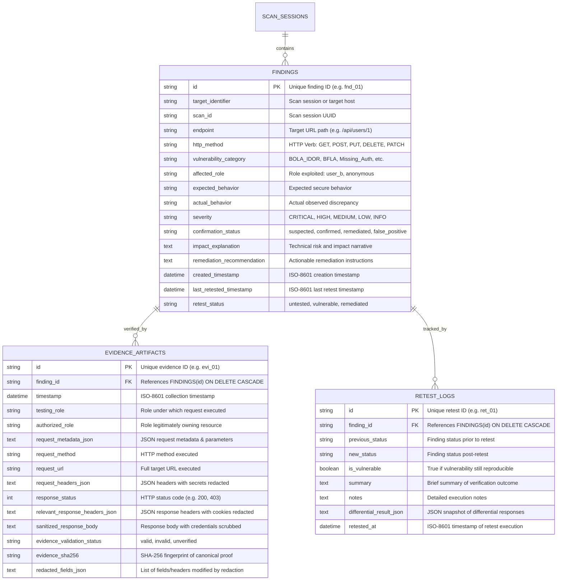

# AuthScope: Storage, Evidence Management & Cross-Module Integration Guide

This document serves as the formal architectural interface contract and integration guide for **AuthScope Layer 4 (Storage & Evidence Management)**. It provides exact, ready-to-use integration instructions for **Member 1 (Scanner & Engine Lead)** and **Member 2 (AI Agent & Vulnerability Analysis Lead)**, ensuring zero compatibility friction and full compliance with `AGENTS.md` and `docs/SECURITY_RULES.md`.

---

## 1. Storage Architecture

AuthScope uses an embedded SQLite database engine managed by `backend.storage.database.DatabaseManager` and queried exclusively through typed repository routines in `backend.storage.finding_repository.FindingRepository`.

### 1.1 Architecture & Trust Boundaries



### 1.2 Core Storage Guarantees

1. **Parameterization Only:** All SQL statements use positional `?` placeholders. Dynamic SQL concatenation is strictly prohibited.
2. **Atomic Session Management:** `db_manager.session_scope()` automatically commits on successful exit or performs rollback upon any exception.
3. **Foreign Key Integrity:** `PRAGMA foreign_keys = ON;` is enforced on every connection. Cascading deletes automatically purge orphaned evidence artifacts and retest logs.
4. **Mandatory Redaction Before Persistence:** Any Bearer token, Basic auth header, session cookie, password, or sensitive credential in URLs or bodies is scrubbed before disk write.

---

## 2. Database Schema (SQLite)



---

## 3. Data Contracts & Pydantic Models

All models reside in `backend.storage.models` and enforce Pydantic v2 validation.

### 3.1 `FindingRecord` Schema

| Field Name | Type | Required | Default | Description |
|---|---|---|---|---|
| `id` | `str` | Yes | Auto-UUID | Unique finding identifier (e.g., `"fnd_idor_01"`). |
| `target_identifier` | `str` | Yes | `""` | Target or scan group ID (alias: `scan_id`). |
| `endpoint` | `str` | Yes | `""` | Target URI path (alias: `target_endpoint`). |
| `http_method` | `str` | Yes | `"GET"` | HTTP Method (`GET`, `POST`, `PUT`, `DELETE`, `PATCH`, `HEAD`, `OPTIONS`). |
| `vulnerability_category` | `str` | Yes | `"BOLA_IDOR"` | Category (alias: `vulnerability_type`). |
| `affected_role` | `str` | Yes | `"user_b"` | Role that bypassed access (alias: `affected_roles`). |
| `expected_behavior` | `str` | Yes | `""` | Expected access control outcome (e.g., `"403 Forbidden"`). |
| `actual_behavior` | `str` | Yes | `""` | Observed bypass (e.g., `"200 OK with User A data"`). |
| `severity` | `SeverityLevel` | No | `MEDIUM` | `CRITICAL`, `HIGH`, `MEDIUM`, `LOW`, `INFO`. |
| `confirmation_status` | `str` | No | `"confirmed"` | `"suspected"`, `"confirmed"`, `"remediated"`, `"false_positive"`. |
| `impact_explanation` | `str` | No | `""` | Narrative detailing business and technical risk (populated by AI). |
| `remediation_recommendation` | `str` | No | `""` | Prescriptive fix advice or code patch (populated by AI). |
| `evidence` | `EvidenceArtifact` | No | `None` | Attached cryptographic evidence artifact. |
| `created_timestamp` | `datetime` | No | `UTC Now` | Creation timestamp (alias: `created_at`). |
| `last_retested_timestamp` | `datetime` | No | `None` | Automatically updated on retest save. |
| `retest_status` | `str` | No | `"untested"` | `"untested"`, `"vulnerable"`, `"remediated"`. |

### 3.2 `EvidenceArtifact` Schema

| Field Name | Type | Required | Default | Description |
|---|---|---|---|---|
| `id` | `str` | Yes | Auto-UUID | Unique evidence identifier (e.g., `"evi_8a4f91c2"`). |
| `finding_id` | `str` | Yes | N/A | Parent finding ID reference. |
| `testing_role` | `str` \| `Role` | No | `user_b` | Role persona executing the unauthorized access. |
| `authorized_role` | `str` \| `Role` | No | `user_a` | Role persona legitimately owning the object. |
| `request_method` | `str` | No | `"GET"` | HTTP method executed. |
| `request_url` | `str` | No | `""` | Target URL (query token parameters automatically redacted). |
| `request_headers` | `Dict[str, str]` | No | `{}` | Headers (`Authorization`, `Cookie`, `X-Api-Key` redacted). |
| `request_metadata` | `Dict[str, Any]` | No | `{}` | Additional parameters (passwords/tokens recursively sanitized). |
| `response_status` | `int` | No | `200` | HTTP status code received. |
| `relevant_response_headers` | `Dict[str, str]` | No | `{}` | Response headers (`Set-Cookie` redacted). |
| `sanitized_response_body` | `str` | No | `""` | Response body (all credentials/JWTs scrubbed). |
| `evidence_validation_status` | `str` | No | `"valid"` | `"valid"`, `"invalid"`, or `"unverified"`. |
| `evidence_sha256` | `str` | No | Auto-hash | 64-character deterministic SHA-256 hash. |
| `redacted_fields` | `List[str]` | No | `[]` | List of headers and fields scrubbed during ingestion. |

### 3.3 `RetestLogRecord` Schema

| Field Name | Type | Required | Default | Description |
|---|---|---|---|---|
| `id` | `str` | Yes | Auto-UUID | Unique retest log record ID. |
| `finding_id` | `str` | Yes | N/A | Finding ID being verified. |
| `previous_status` | `str` | Yes | `"confirmed"` | Status prior to retest. |
| `new_status` | `str` | Yes | `"remediated"` | New status after differential verification. |
| `is_vulnerable` | `bool` | Yes | `False` | `True` if still vulnerable; `False` if remediated. |
| `summary` | `str` | No | `""` | High-level outcome summary. |
| `notes` | `str` | No | `""` | Detailed technical notes or failure reasons. |
| `retested_at` | `datetime` | No | `UTC Now` | Timestamp when retest was executed. |

---

## 4. Repository Functions & Signatures

Initialize the repository:
```python
from backend.storage.finding_repository import FindingRepository

repo = FindingRepository()
```

### 4.1 Interface Specification

```python
def initialize_database(self) -> None:
    """Explicitly initializes or verifies tables and indexes in the SQLite database."""

def save_finding(
    self,
    finding: Union[FindingRecord, Dict[str, Any]],
    overwrite: bool = False
) -> str:
    """Inserts a finding and its nested EvidenceArtifact into SQLite.
    
    Raises:
        DuplicateRecordError: If finding.id exists and overwrite=False.
        InvalidDataError: If validation fails.
    Returns:
        The finding ID string.
    """

def get_finding(self, finding_id: str) -> Optional[FindingRecord]:
    """Retrieves finding by ID including its nested EvidenceArtifact if present."""

def get_all_findings(
    self,
    target_identifier: Optional[str] = None,
    scan_id: Optional[str] = None,
    status: Optional[str] = None,
    severity: Optional[Union[SeverityLevel, str]] = None,
    vulnerability_category: Optional[str] = None
) -> List[FindingRecord]:
    """Queries findings matching filters, ordered by created_timestamp DESC."""

def list_findings(self, scan_id: Optional[str] = None) -> List[FindingRecord]:
    """Backwards-compatible convenience alias for get_all_findings(scan_id=scan_id)."""

def update_finding(
    self,
    finding_id: str,
    update_data: Union[FindingRecord, Dict[str, Any]]
) -> FindingRecord:
    """Updates fields of an existing finding (e.g. AI-generated severity, remediation).
    
    Raises:
        RecordNotFoundError: If finding_id does not exist.
        InvalidDataError: If validation fails.
    Returns:
        The updated FindingRecord.
    """

def save_retest_result(
    self,
    retest: Union[RetestLogRecord, Dict[str, Any]]
) -> str:
    """Saves a verification retest log and updates the finding's last_retested_timestamp
    and retest_status ('vulnerable' or 'remediated').
    
    Raises:
        RecordNotFoundError: If finding_id does not exist.
        InvalidDataError: If validation fails.
    Returns:
        The retest record ID string.
    """

def get_retest_history(
    self,
    finding_id: Optional[str] = None
) -> List[RetestLogRecord]:
    """Retrieves historical retest records, ordered by retested_at DESC."""

def delete_finding(self, finding_id: str) -> bool:
    """Deletes finding and cascades deletion to evidence and retest logs.
    
    Returns:
        True if deleted, False if not found.
    """
```

---

## 5. Scanner Integration Guide (Member 1)

### 5.1 Mapping Scanner Results to Storage

Member 1's scanner pipeline generates differential results:
- `DifferentialResult` (`backend.scanner.authorization_tester.py`)
- `HttpResponseModel` (`backend.scanner.request_executor.py`)

When an unauthorized access discrepancy is detected:
1. `DifferentialResult.endpoint` $\rightarrow$ `FindingRecord.endpoint`
2. `DifferentialResult.method` $\rightarrow$ `FindingRecord.http_method`
3. `DifferentialResult.vulnerability_candidate` $\rightarrow$ `FindingRecord.vulnerability_category`
4. The unauthorized probe response `HttpResponseModel` $\rightarrow$ `EvidenceArtifact`

### 5.2 Step-by-Step Code Example for Member 1

```python
from backend.storage.finding_repository import FindingRepository
from backend.storage.models import FindingRecord, EvidenceArtifact, SeverityLevel
from backend.scanner.authorization_tester import DifferentialResult
from backend.scanner.request_executor import HttpResponseModel
from backend.core.session_manager import Role

def persist_scanner_finding(
    repo: FindingRepository,
    diff_result: DifferentialResult,
    target_id: str,
    test_role: Role,
    response: HttpResponseModel,
    request_headers: dict
) -> str:
    """Helper for Member 1 to persist detected authorization bypass."""
    finding_id = f"fnd_{diff_result.method.lower()}_{diff_result.endpoint.replace('/', '_').strip('_')}"
    
    # 1. Construct EvidenceArtifact
    # NOTE: Sensitive headers (Authorization, Cookie, etc.) and bodies are AUTOMATICALLY redacted
    evidence = EvidenceArtifact(
        id=f"evi_{finding_id}",
        finding_id=finding_id,
        testing_role=test_role,
        authorized_role=Role.USER_A,
        request_method=diff_result.method,
        request_url=f"http://localhost:3000{diff_result.endpoint}",
        request_headers=request_headers,
        response_status=response.status_code,
        relevant_response_headers=response.headers,
        sanitized_response_body=response.body,
        evidence_validation_status="valid"
    )

    # 2. Construct FindingRecord
    finding = FindingRecord(
        id=finding_id,
        target_identifier=target_id,
        endpoint=diff_result.endpoint,
        http_method=diff_result.method,
        vulnerability_category=diff_result.vulnerability_candidate or "BOLA_IDOR",
        affected_role=test_role.value if hasattr(test_role, "value") else str(test_role),
        expected_behavior="HTTP 403 Forbidden for unauthorized persona",
        actual_behavior=f"HTTP {response.status_code} OK permitted access",
        severity=SeverityLevel.HIGH,
        confirmation_status="confirmed" if diff_result.is_discrepancy_detected else "suspected",
        evidence=evidence
    )

    # 3. Persist via parameterized repository call
    return repo.save_finding(finding, overwrite=True)
```

---

## 6. AI Agent Integration Guide (Member 2)

### 6.1 Finding Analysis & Enrichment Workflow

Member 2's AI agent operates on verified findings:
1. Agent queries suspected or unanalyzed findings via `repo.get_all_findings(status="suspected")`.
2. Claude 3.5 Sonnet evaluates the differential evidence, determining business risk and root cause.
3. Agent synthesizes:
   - Evaluated `severity` (e.g. `CRITICAL`, `HIGH`, `MEDIUM`)
   - `impact_explanation` (business and technical risks)
   - `remediation_recommendation` (code-level patch instructions)
   - `confirmation_status` (`confirmed` or `false_positive`)
4. Agent updates the record in-place using `repo.update_finding(finding_id, update_dict)`.

### 6.2 Step-by-Step Code Example for Member 2

```python
from backend.storage.finding_repository import FindingRepository
from backend.storage.models import SeverityLevel

def enrich_finding_with_ai_analysis(repo: FindingRepository, finding_id: str) -> None:
    """Helper for Member 2 to retrieve finding, run AI analysis, and persist updates."""
    # 1. Retrieve finding from storage
    finding = repo.get_finding(finding_id)
    if not finding:
        raise ValueError(f"Finding {finding_id} not found")

    # 2. Inspect sanitized evidence (safe from raw credentials)
    endpoint = finding.endpoint
    response_body = finding.evidence.sanitized_response_body if finding.evidence else ""

    # 3. Simulated AI reasoning output (from Claude 3.5 Sonnet prompt)
    ai_analysis_result = {
        "severity": SeverityLevel.CRITICAL,
        "confirmation_status": "confirmed",
        "impact_explanation": (
            f"Horizontal privilege escalation on {endpoint}: User B can read and manipulate "
            "private shopping baskets belonging to User A, resulting in full customer PII exposure."
        ),
        "remediation_recommendation": (
            "Enforce object ownership verification middleware:\n"
            "```python\n"
            "@router.get('/rest/basket/{basket_id}')\n"
            "def get_basket(basket_id: int, current_user: User = Depends(get_current_user)):\n"
            "    basket = db.get_basket(basket_id)\n"
            "    if basket.owner_id != current_user.id and not current_user.is_admin:\n"
            "        raise HTTPException(status_code=403, detail='Access denied')\n"
            "    return basket\n"
            "```"
        )
    }

    # 4. In-place update to SQLite
    updated_finding = repo.update_finding(finding_id, ai_analysis_result)
    assert updated_finding.severity == SeverityLevel.CRITICAL
```

---

## 7. Retest & Verification Workflow

When an engineer deploys a remediation patch, AuthScope verifies the fix non-destructively:

```python
from backend.storage.finding_repository import FindingRepository
from backend.storage.models import RetestLogRecord

def record_retest_execution(
    repo: FindingRepository,
    finding_id: str,
    is_vulnerable: bool,
    summary_text: str
) -> str:
    """Records retest outcome and transitions finding status."""
    retest = RetestLogRecord(
        id=f"ret_{finding_id}_{datetime.now().strftime('%Y%m%d%H%M%S')}",
        finding_id=finding_id,
        previous_status="confirmed",
        new_status="remediated" if not is_vulnerable else "confirmed",
        is_vulnerable=is_vulnerable,
        summary=summary_text,
        notes="Automated replay completed via RetestEngine."
    )

    # Persists retest log and updates finding.retest_status & finding.last_retested_timestamp
    return repo.save_retest_result(retest)
```

---

## 8. Error Handling Matrix

All custom storage exceptions derive from `AuthScopeException` in `backend.utils.helpers`:

| Exception | Raised When | Member Action Required |
|---|---|---|
| `DuplicateRecordError` | Finding ID already exists and `overwrite=False` | Pass `overwrite=True` to update, or generate unique ID |
| `RecordNotFoundError` | Updating or fetching non-existent finding ID | Check finding ID validity before updating |
| `InvalidDataError` | Pydantic validation fails (bad method, missing fields) | Fix input structure to conform to `FindingRecord` schema |
| `StorageError` | SQLite transaction error or unrecoverable disk issue | Check filesystem permissions / disk availability |

---

## 9. Running Verification Tests

To verify storage, cross-module integration, and end-to-end QA:

```powershell
# Run the complete test suite (all 46 tests)
.\.venv\Scripts\python.exe -m pytest -v

# Run storage & cross-module integration tests specifically (17 tests)
.\.venv\Scripts\python.exe -m pytest tests/test_storage.py -v

# Run only cross-module integration tests
.\.venv\Scripts\python.exe -m pytest tests/test_storage.py -k "TestCrossModuleIntegration" -v

# Run end-to-end integration and security QA tests (10 tests)
.\.venv\Scripts\python.exe -m pytest tests/test_end_to_end_integration.py -v
```
