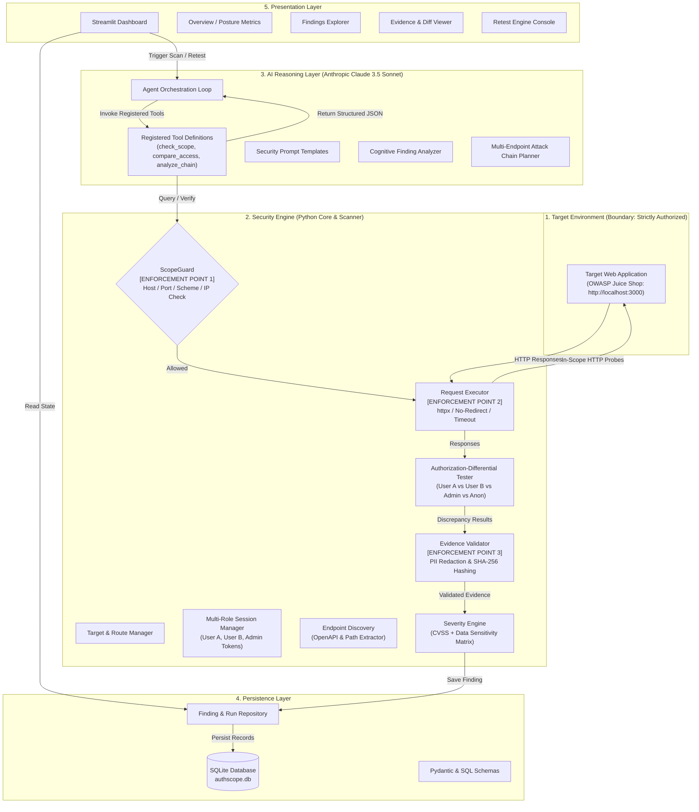

# AuthScope: System Architecture

## 1. Architectural Philosophy

AuthScope enforces a strict **separation between execution authority and cognitive reasoning**:
- **Python Security Engine:** Sole authority over network sockets, scope enforcement, HTTP request generation, response capture, and cryptographic evidence hashing.
- **AI Agent (Claude 3.5 Sonnet):** Cognitive strategist that inspects discovered endpoints, proposes authorization test hypotheses, formulates attack chains, and produces remediation code.

The AI agent **never** makes direct network requests and **never** has permission to modify scope rules.

---

## 2. Five-Layer Architecture Diagram



---

## 3. Component Responsibilities

### Layer 1: Target Environment
- **Target Application:** The web system under test. For the MVP, this is local OWASP Juice Shop (`http://localhost:3000`).

### Layer 2: Core Security Engine
- `backend.core.scope_guard.ScopeGuard`: First line of defense. Evaluates every URL before any socket is opened. Checks hostname, IP resolution, port, and URL scheme against strict allowlists.
- `backend.core.target_manager.TargetManager`: Manages application metadata, base URLs, and active test paths.
- `backend.core.session_manager.SessionManager`: Automates role authentication, manages JWTs/cookies, and keeps identities completely isolated.
- `backend.scanner.source_analyzer.SourceAnalyzer`: Offline multi-language static code analyzer (Python, JS, TS). Never executes target code, never makes network calls. Enforces hard file and repo size bounds, excludes secrets/private keys. Outputs `DETECTED_CODE_PATTERN` or `POTENTIAL_VULNERABILITY`, NEVER confirmed vulnerabilities.
- `backend.scanner.source_analyzer.ProjectDependencyAnalyzer`: Builds lightweight cross-file dependency graph (`ProjectDependencyGraph`) across Python modules, resolving imports, custom decorators, FastAPI dependencies (`Depends`, `Security`), router prefixes, and middleware to prevent false positives when auth checks live in external files, and explicitly flagging `INCONCLUSIVE` uncertainty when external dependencies cannot be resolved.
- `backend.scanner.request_executor.RequestExecutor`: Low-level HTTP executor using `httpx`. Sets request timeouts, enforces disabled redirects, and intercepts response headers and body.
- `backend.scanner.authorization_tester.AuthorizationTester`: Executes cross-role comparative matrix tests on target endpoints, generates raw diff metrics, and uniquely holds the authority to promote potential findings to `CONFIRMED_RUNTIME_VULNERABILITY` via `verify_potential_finding`.
- `backend.analysis.evidence_validator.EvidenceValidator`: Sanitizes sensitive tokens, evaluates response status differences, and computes an SHA-256 checksum across request/response pairs.
- `backend.analysis.severity_engine.SeverityEngine`: Applies an objective risk rubric based on data sensitivity and access level.
- `backend.github_integration.GitHubAppService`: Separate fixed-host account provider client. It authorizes GitHub App users, validates installation access, retrieves bounded source blobs at a pinned commit, and invokes the existing offline source analyzer. Its GitHub-only `ScopeGuard` does not change target scan scope.

### Layer 3: AI Reasoning Layer
- `backend.agent.agent.AuthScopeAgent`: Manages the agent loop, calling Claude 3.5 Sonnet with tool descriptions and system instructions.
- `backend.agent.tools.AgentTools`: Implements strict Pydantic-validated tool functions callable by the model.
- `backend.agent.attack_chain.AttackChainPlanner`: Detects cross-endpoint vulnerabilities where state from endpoint X enables unauthorized access at endpoint Y.

### Layer 4: Persistence Layer
- `backend.storage.database.DatabaseManager`: Manages SQLite connections and schema initialization.
- `backend.storage.finding_repository.FindingRepository`: Provides atomic CRUD operations for scans, findings, evidence, and retest logs.

### Layer 5: Presentation Layer
- `dashboard/app.py`: Streamlit-based cybersecurity console providing real-time visibility into active scans, findings, evidence verification, and retest triggers.

---

## 4. Trust Boundaries & Security Enforcement Points

```
[ UNTRUSTED AI OUTPUT ]
         │
         ▼
[ ENFORCEMENT POINT 1: Pydantic Schema Validation ]
         │ (rejects malformed types, arbitrary shell parameters)
         ▼
[ ENFORCEMENT POINT 2: ScopeGuard Allowlist Validation ]
         │ (rejects non-allowlisted domains, ports, schemes, metadata IPs)
         ▼
[ ENFORCEMENT POINT 3: Safe Request Execution (httpx) ]
         │ (follow_redirects=False, strict 10s timeout, safe HTTP methods)
         ▼
[ TARGET SYSTEM (OWASP Juice Shop) ]
         │
         ▼
[ ENFORCEMENT POINT 4: Evidence Sanitizer & Validator ]
         │ (redacts Bearer tokens, passwords, cookies before DB write)
         ▼
[ SECURE AUDIT STORAGE (SQLite) ]
```

1. **Enforcement Point 1 (Schema Boundary):** The AI cannot call unexposed tools or inject raw Python/OS commands.
2. **Enforcement Point 2 (Network Perimeter Guard):** The `ScopeGuard` enforces that no request escapes `http://localhost:3000`.
3. **Enforcement Point 3 (HTTP Execution Control):** Disables automatic redirect following to prevent SSRF and forces tight socket timeouts.
4. **Enforcement Point 4 (Data Redaction):** All sensitive tokens and credentials are masked before writing to the database or UI.

