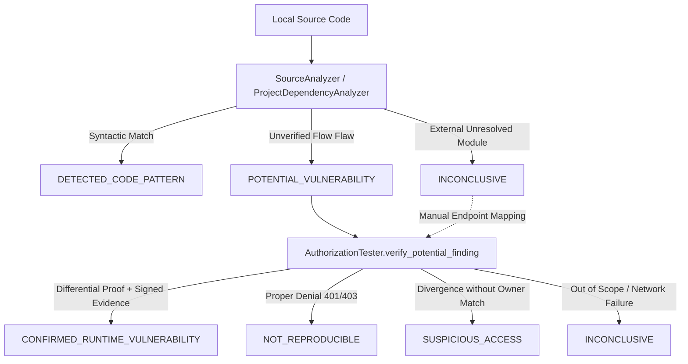

# AuthScope: Vulnerability Detection Methodology

This document details the Phase 3 authorization-differential detection engine, response analysis pipeline, verdict classification, and false-positive mitigation protocols.

---

## 1. Four-State Access Verdict Classification

AuthScope never treats an HTTP `200 OK` status code alone as proof of an authorization vulnerability. Every comparative probe is classified by `ResponseAnalyzer` into one of four explicit verdicts (`AccessVerdict`):

| Verdict | Criteria | Finding Status |
|---|---|---|
| **`ALLOWED_ACCESS`** | Role is authorized by policy (e.g., resource owner, Admin on admin route, or any role on a `PUBLIC` route) or response is properly self-scoped to the caller's own identity. | No finding |
| **`CORRECTLY_DENIED`** | Target returns `401`/`403`/`404`, soft JSON error (`{"status": "error"}`), empty payload (`{"user": {}}`), or a generic SPA HTML fallback shell (`index.html`). | Secure |
| **`SUSPICIOUS_ACCESS`** | Unauthorized role receives `200 OK` with non-empty data, but response differs from the owner baseline or lacks conclusive ownership identifiers. | Requires review (`SUSPICIOUS`) |
| **`CONFIRMED_UNAUTHORIZED_ACCESS`** | Unauthorized role receives `200 OK` with valid structured JSON matching the owner's baseline resource ID, owner identifier (`UserId` / `email`), or sensitive fields, backed by a validated `EvidenceArtifact`. | Confirmed (`CONFIRMED`) |

---

## 2. Vulnerability Classes Detected

### A. Broken Object Level Authorization (BOLA / IDOR)
- **Endpoint Category:** `EndpointCategory.USER_OBJECT` (e.g., `/rest/basket/{id}`, `/api/Users/{id}`, `/api/Addresss/{id}`, `/api/Cards/{id}`).
- **Differential Workflow:**
  1. Verify `owner_role` (`User A`) and `test_role` (`User B`, `Anonymous`) have active sessions in `SessionManager`.
  2. Resolve concrete `resource_id` explicitly provided or registered to `User A` (never inventing resource ownership).
  3. Request resource as `User A` and inspect baseline (`ResponseInspection`).
  4. Request identical resource URL as `User B` and `Anonymous`.
  5. Compare responses: confirm `BOLA_IDOR` only when `User B` receives `200 OK` JSON containing `User A`'s resource ID, owner ID/email, or sensitive attributes with high structural similarity ($\ge 0.85$).

### B. Broken Function Level Authorization (BFLA)
- **Endpoint Category:** `EndpointCategory.ADMIN_FUNCTION` (e.g., `/api/Users`, `/rest/admin/application-configuration`).
- **Differential Workflow:**
  1. Execute baseline GET request as `Role.ADMIN`.
  2. Execute identical GET request as `Role.USER_A` and `Role.ANONYMOUS`.
  3. If unprivileged roles receive the protected administrative dataset, classify as `BFLA`.

### C. Missing Authentication (`MISSING_AUTH`)
- **Pattern:** Non-public endpoints that return protected data when queried under `Role.ANONYMOUS` with zero authentication headers.

---

## 3. Multi-Layer False Positive Mitigation

Modern Single-Page Applications (SPAs) such as OWASP Juice Shop frequently return `HTTP 200 OK` for invalid or unauthorized routes. `ResponseAnalyzer` enforces five false-positive guards:

1. **SPA HTML Shell Detection (`is_spa_fallback`):** Detects when an API route returns `text/html` containing `<!doctype html>` / `<app-root>` instead of JSON data. Classified as `CORRECTLY_DENIED`.
2. **Empty Payload Detection (`is_empty_payload`):** Detects responses like `{"user": {}}` or `{"data": []}` (e.g., `/rest/user/whoami` when unauthenticated). Classified as `CORRECTLY_DENIED`.
3. **Soft Error Payload Inspection (`has_error_indicator`):** Inspects JSON keys (`error`, `errors`, `status: "error"`, `message: "Unauthorized"`) inside HTTP 200 responses.
4. **Self-Reflection Guard:** Checks whether an endpoint (such as a profile or current-user route) simply returned `User B`'s own `UserId` or `email` rather than `User A`'s data. Classified as `ALLOWED_ACCESS`.
5. **Evidence Completeness Gate (`validate_artifact_completeness`):** A finding is downgraded from `CONFIRMED` to `SUSPICIOUS` if the `EvidenceArtifact` is missing any mandatory field or fails cryptographic SHA-256 verification.

---

## 4. Strict Static vs Runtime Finding Classification Lifecycle

To prevent speculation and hallucinations, AuthScope enforces a strict separation between static code analysis observations and verified runtime exploitability:

### Finding Classification States

| Classification | Meaning | Generating Component | Can Trigger Runtime Retest? |
|---|---|---|---|
| **`DETECTED_CODE_PATTERN`** | Recognized code idiom matching a vulnerability pattern without context verification. | `SourceAnalyzer` | Yes (if route mapped) |
| **`POTENTIAL_VULNERABILITY`** | Static analysis suggests an unmitigated vulnerability (e.g. unauthenticated admin route, direct un-scoped ID lookup). Never claims runtime exploitability. | `SourceAnalyzer` | Yes |
| **`CONFIRMED_RUNTIME_VULNERABILITY`** | Reproducible, non-destructive HTTP evidence demonstrating an actual security violation across roles. | `AuthorizationTester` ONLY | Yes |
| **`NOT_REPRODUCIBLE`** | Differential testing disproved vulnerability; target properly enforced authentication/authorization (401/403). | `AuthorizationTester` | Yes (for regression check) |
| **`INCONCLUSIVE`** | Verification cannot be completed due to out-of-scope target, unresolved external dependencies, or unmapped routes. | `SourceAnalyzer` / `AuthorizationTester` | Yes |
| **`SUSPICIOUS_ACCESS`** | Behavioral divergence observed between roles, but lacks complete evidence or owner-identifier matching. | `AuthorizationTester` | Yes |

### Mandatory Confirmed Finding Verification Package

Every `CONFIRMED_RUNTIME_VULNERABILITY` record returned by `AuthorizationTester.verify_potential_finding` must include:
1. **Affected Endpoint & HTTP Method:** Full normalized route and HTTP verb.
2. **Relevant Authentication Roles:** Legitimate owner role (`Role.USER_A`) and unauthorized probe role (`Role.USER_B` / `Role.ANONYMOUS`).
3. **Redacted Evidence:** Request headers, request URL, response status, and response excerpt with all Bearer tokens and sensitive credentials redacted.
4. **Expected vs. Actual Behavior:** Explicit contrast between authorization policy requirements and observed system violation.
5. **Step-by-Step Reproduction Steps:** Deterministic, human-readable execution sequence detailing baseline check, unauthorized probe check, discrepancy observed, and SHA-256 evidence integrity hash.
6. **Confidence & Severity Rating:** Standardized `ConfidenceLevel.CONFIRMED` and risk-weighted `SeverityLevel`.
7. **Recommended Fix:** Actionable server-side architectural remediation guidance.
